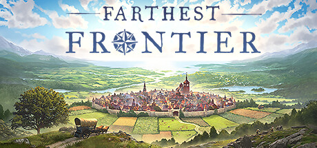

**Farthest Frontier by Crate Entertainment (2022) is a medieval city builder with deep survival mechanics.**

---

## 📖 About

Farthest Frontier by Crate Entertainment (2022) is a medieval city builder with deep survival mechanics. Your settlers face starvation, disease, raids, and harsh winters while you build a self-sustaining frontier town from scratch. Every system is interconnected and every mistake has downstream consequences.

## ⚠️ Problems Without Trainer

| Problem | Status |
|---------|--------|
| Winter food reserves deplete before spring harvest leaving settlers to starve | ✅ Solved |
| Disease outbreaks cascade through the entire population without healers | ✅ Solved |
| Raider attacks scale to village size faster than defenses can be constructed | ✅ Solved |
| Firewood production requires complex overlapping forester and woodcutter chains | ✅ Solved |
| Soil depletion forces farm rotation breaking established food supply timing | ✅ Solved |

## ✅ Solution

The **Farthest Frontier Trainer** solves all these issues, giving you complete control so you can focus on enjoying the game.

## 🎯 Features

- Unlimited Resources / Currency
- God Mode / Invincibility
- Instant Skill & Ability Cooldown
- One-Hit Kill
- Freeze Timers
- Unlock All Items & Achievements
- Custom Speed Multiplier
- Infinite Stamina / Energy

## 🚀 Quick Start

1. **Disable Windows Defender** temporarily (trainer may trigger false positive)
2. Get the trainer from the button above
3. Launch Farthest Frontier
4. Run the trainer as Administrator
5. Use the hotkeys to activate cheats in-game

## 💎 Free vs Pro

| Feature | Free | Pro |
|---------|------|-----|
| God Mode | ✅ | ✅ |
| Unlimited Resources | ✅ | ✅ |
| Advanced Cheats | ❌ | ✅ |
| Auto-Updates | ❌ | ✅ |
| Priority Support | ❌ | ✅ |

## 💻 Requirements

- Windows 10 / 11 (64-bit)
- Farthest Frontier (any version)
- .NET Framework 4.8+
- DirectX 11+

## 🍎 macOS

## ⚖️ Legal

Educational and single-player use only.

---

